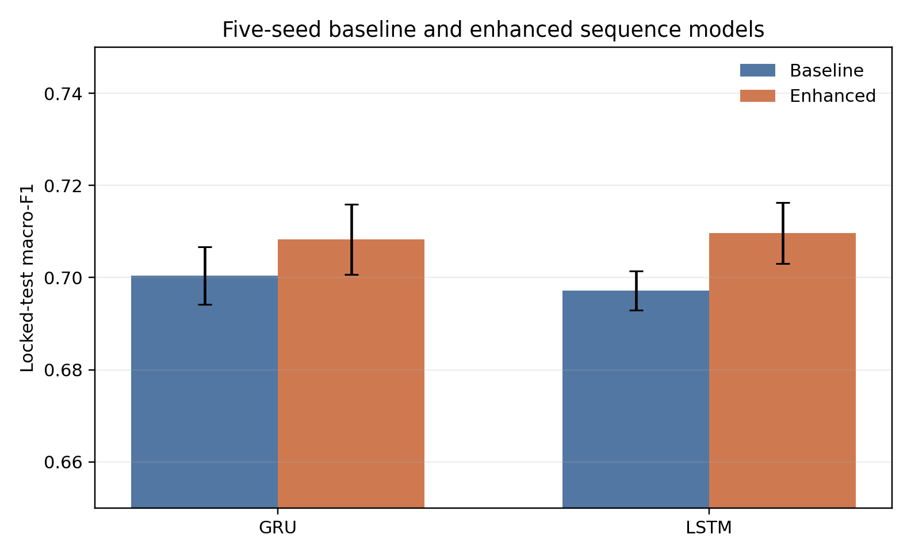
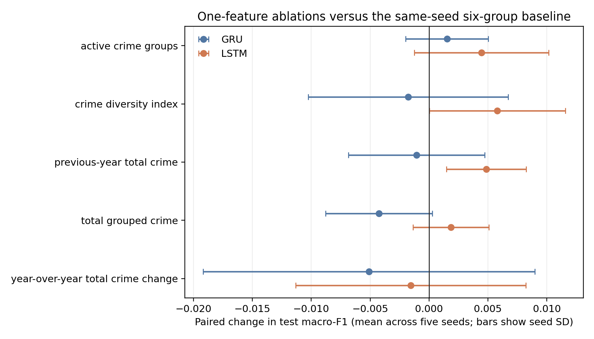
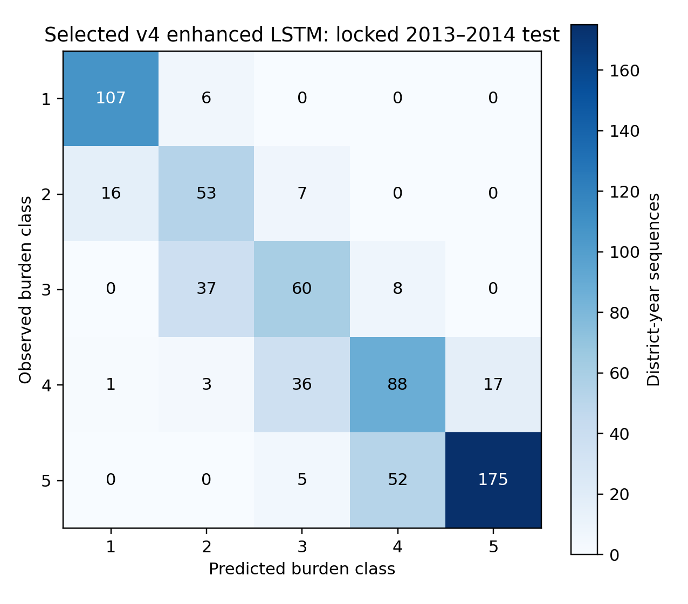

# Forecasting ordered district-year violent-crime burden in India: a reproducible temporal comparison

**Status:** New project draft created because no manuscript or conference template was found. This is not submission-ready; see author checklist at the end.

**Keywords:** NCRB; crime burden; temporal classification; district-year panel; GRU; LSTM; target leakage; India.

## Abstract

We evaluate whether prior-year district-level IPC crime information can forecast an ordered five-level violent-crime burden category for the next year. The project integrates district-year IPC measures for 2001–2014, constructs a burden target with four cutoffs frozen from 2001–2010 training observations (107, 237, 362 and 563), and compares lagged tabular logistic regression with GRU and LSTM sequence models. The chronological design uses 2001–2010 for training, 2011–2012 for validation and 2013–2014 as a locked test period. Sequences require three consecutive prior years for the same district. On the saved 671-row test cohort, v4 baseline macro-F1 was 0.7020 for GRU, 0.7041 for LSTM and 0.6761 for logistic regression; the majority baseline was 0.1028. Across five training seeds, enhanced-minus-baseline macro-F1 averaged +0.00785 for GRU and +0.01248 for LSTM, with seed standard deviations 0.00772 and 0.00767. Improvements were not consistent across every architecture and metric. The available evidence supports a structural chronological evaluation, but source crosswalk gaps, missing upstream records and unavailable release dates limit interpretation as operational forecasting. These results do not establish causal feature importance or statistical significance.

## 1. Introduction and research objectives

Crime forecasting studies evaluate future outcomes using temporal and spatial predictors; sequence models are one established approach to temporal data [1, 2]. This study asks a narrower district-year question: given crime information observed for a district through year *t−1*, how well can a model classify that district's violent-crime burden in year *t*? The target is an ordered project-defined burden category, not an incident-level forecast and not a causal measure.

The objectives are (i) define and preserve a training-derived target scale, (ii) compare lagged tabular and three-year recurrent models under a chronological split, and (iii) quantify sensitivity to initialization using five fixed seeds. A same-year random-split notebook experiment is retained only as observed-year classification and is not used as forecasting evidence.

## 2. Related work

Crime-prediction research includes spatial-temporal modeling and deep sequence approaches. Mao et al. study city-partition crime-count sequences with deep-learning models and discuss how target binning affects forecasting performance [1]. The present study differs in unit and target: annual district-level ordered burden categories derived from NCRB IPC data. The original LSTM formulation provides background for the recurrent sequence model [2]. These references motivate temporal evaluation; they do not establish that this dataset's source variables are available by a real forecast date.

## 3. Data and preprocessing

The analysis uses the project's integrated district-year IPC dataset for 2001–2014. The Government of India's OGD catalog identifies district-wise IPC crime data and NCRB as contributor, and cites *Crime in India 2014* for the cataloged 2014 data [3]. The local repository contains normalized/integrated processed stages but not the original upstream raw source files. Consequently, this attribution does not by itself document every local transformation or year-specific category crosswalk.

The primary target source is `VIOLENT_CRIME_BURDEN`; five ordered levels use frozen upper boundaries 107, 237, 362 and 563 estimated only from the 2001–2010 training period. The right-closed rule assigns class 1 to burden ≤107, class 2 to (107, 237], class 3 to (237, 362], class 4 to (362, 563], and class 5 to burden >563. These are project-defined labels (lowest, low-to-moderate, moderate, moderate-to-high, highest); they are not official NCRB classes. The processed target distribution contains 1,938, 1,824, 1,831, 1,968 and 2,070 observations in classes 1–5 respectively, with 225 missing targets among 9,856 rows. The locked 671-row test cohort has class supports 113, 76, 105, 145 and 232 respectively.

Six grouped crime predictors are row-wise sums of their recovered IPC columns, with `min_count=1`: all-missing components remain missing and partial sums include observed components only. Formula checks against the stored grouped dataset reported zero row-value mismatches. These grouped sources overlap directly with target construction; therefore same-year counts are invalid for forecasting and the experiment uses prior-year inputs. Component completeness and observed zeros are detailed in the audit artifacts. Nine direct source overlaps are documented; legal relationships among offence definitions do not determine NCRB's case-counting or category-tabulation behavior.

The nine direct shared inputs are `IPC_ATTEMPT_TO_MURDER`, `IPC_CULPABLE_HOMICIDE_NOT_AMOUNTING_TO_MURDER`, `IPC_MURDER`, `IPC_KIDNAPPING_ABDUCTION`, `IPC_ARSON`, `IPC_RIOTS`, `IPC_DACOITY`, `IPC_ROBBERY`, and `IPC_RAPE`. The audit sums these source counts over valid-target rows where values are observed (3,228,843) and divides by the summed target burden over all 9,631 valid-target rows (4,215,620), giving a descriptive ratio of 76.592%. There are 9,552 valid-target rows with at least one observed direct-overlap value; 79 have none. This ratio is not a row-wise decomposition proof and does not show that the class can be reconstructed deterministically. The ten grouped source columns without a direct source-column match have not been established as free from indirect semantic overlap; NCRB category/accounting documentation is absent.

Missingness has distinct levels. There are 225 missing targets and 225 missing values in each grouped predictor; the group formulas report 225 rows with all components missing. Partial-component missingness is much more common (for example, 9,631 property-group rows have at least one missing component), while observed zeros remain observed zeros. Thus a nonmissing grouped value may be a partial sum, not a complete total. The source does not encode why a value is missing, so missing is not interpreted as zero or as a specific reporting failure. Of 9,631 target observations, 2,469 lack at least one required historical district-year record for the three-year sequence; enhanced features reject a further 1,320 otherwise eligible histories with incomplete/nonfinite inputs. The 225 missing targets, partial grouped values, absent historical records and incomplete feature histories are not conflated.

Two schema gaps remain unresolved. Normalized 2001–2013 tables use the heading `COUNTERFIETING`, while canonical `IPC_COUNTERFEITING` lacks integrated observations for those years. In 2014, alternative attempt-to-murder and burglary headings are present without a verified crosswalk to the older canonical fields. No automatic renaming, summation or replacement was made. Seven duplicate normalized district-year key groups (14 rows) were found in five cleaned files; the integration quality rule excludes all seven from core. Two Railway groups have conflicting offense payloads whose original subunit identities are unavailable.

## 4. Target definition and evaluation protocol

The prediction unit is `(YEAR, STATE, UNIT_NAME)`. For target year *t*, tabular features use the exact same district's source values in *t−1*. Recurrent examples use that district's exact consecutive *t−3*, *t−2*, and *t−1* records to predict the label for *t*. Invalid/missing histories are rejected rather than synthesized. The split is chronological: train 2001–2010, validation 2011–2012, locked test 2013–2014. Thresholds remain fixed across partitions.

The ordered target is a project-defined adaptation: recovered project evidence does not establish that these IPC burden inputs or cutoffs reproduce the cited study's label procedure. Of 9,856 integrated rows, 9,631 have a valid burden target and 225 do not. The complete valid-target class counts are 1,938 / 1,824 / 1,831 / 1,968 / 2,070. Strict sequence construction yields 7,161 baseline sequences and 5,842 enhanced sequences; the paired recurrent comparison uses the 5,842-row common cohort (3,847 train, 1,324 validation, 671 test). The sequence-class distributions are shown below. The test supports differ from the full target-year distribution because incomplete district histories and feature rows are rejected.

| Partition | Sequence rows | Class 1 | Class 2 | Class 3 | Class 4 | Class 5 |
|---|---:|---:|---:|---:|---:|---:|
| Train | 3,847 | 728 | 758 | 794 | 787 | 780 |
| Validation | 1,324 | 245 | 204 | 225 | 310 | 340 |
| Locked test | 671 | 113 | 76 | 105 | 145 | 232 |

For neural models, feature scaling is fit on training sequences for validation-based epoch selection and fit again on train plus validation before locked test inference. Model/epoch and logistic regularization selection use validation only. Test labels and predictions do not select models. Structural negative tests cover same-year and target-derived features, wrong lags, cross-district histories, duplicate keys, future-value perturbations and incomplete sequences. Annual release dates and a declared real-world forecast issue date are absent, so the audit establishes source-year structural eligibility, not operational availability by a particular date.

The GRU and LSTM use the saved corrected-v4 controlled architecture and sequence procedure; the baseline uses six grouped lag features, while the enhanced configuration adds the five engineered lagged predictors. Logistic regression and a majority classifier provide tabular and naive baselines. Metrics include accuracy, macro and weighted F1, per-class precision/recall/F1, confusion matrices, macro one-vs-rest ROC-AUC and the unweighted mean of class-wise one-vs-rest average precision. Macro F1 treats each class equally [4].

## 5. Results

### Saved corrected-v4 metrics

| Variant | Model | Accuracy | Macro F1 | Weighted F1 | Macro OvR ROC-AUC | Macro mean OvR AP |
|---|---|---:|---:|---:|---:|---:|
| Baseline | GRU | 0.7168 | 0.7020 | 0.7228 | 0.9375 | 0.7246 |
| Enhanced | GRU | 0.7198 | 0.7054 | 0.7250 | 0.9345 | 0.7133 |
| Baseline | LSTM | 0.7228 | 0.7041 | 0.7275 | 0.9374 | 0.7209 |
| Enhanced | LSTM | 0.7198 | 0.6996 | 0.7240 | 0.9354 | 0.7244 |
| Baseline | Logistic regression | 0.6960 | 0.6761 | 0.7019 | 0.9327 | 0.7095 |
| Enhanced | Logistic regression | 0.6975 | 0.6762 | 0.7026 | 0.9312 | 0.7059 |
| Majority | Majority classifier | 0.3458 | 0.1028 | 0.1777 | 0.5000 | 0.2000 |

All eight saved v4 metric rows were independently recomputed from stored labels/probabilities and matched. Per-class results and confusion matrices are archived with the audit.

### Five-seed controlled comparison

The paired enhanced-minus-baseline macro-F1 differences across seeds 11, 23, 37, 53 and 71 averaged +0.00785 (SD 0.00772) for GRU and +0.01248 (SD 0.00767) for LSTM; logistic regression averaged +0.00016 (SD 0). LSTM macro-F1 was higher in all five seeds; GRU in four. ROC-AUC and AP trends were mixed, so no universal enhanced-model advantage is claimed. Seed variability is not a confidence interval or a significance test; the fixed test rows are dependent across districts and adjacent years.

### One-feature ablations

The seed-42 v4 ablation remains saved separately. All 50 five-seed feature/model fits completed and passed a key-and-pairing audit. Each value below is the mean over seeds of the feature model's macro-F1 minus its same-seed, same-architecture six-group baseline; parentheses give across-seed SD.

| One engineered feature added | GRU paired Δ macro-F1 (SD) | LSTM paired Δ macro-F1 (SD) |
|---|---:|---:|
| Total grouped crime | −0.00425 (0.00454) | +0.00186 (0.00322) |
| Active crime groups | +0.00152 (0.00350) | +0.00446 (0.00571) |
| Crime diversity index | −0.00178 (0.00848) | +0.00580 (0.00577) |
| Previous-year total crime | −0.00106 (0.00580) | +0.00487 (0.00339) |
| Year-over-year total crime change | −0.00511 (0.01408) | −0.00156 (0.00978) |

The GRU differences are higher in 3/5 seeds for active crime groups, 2/5 for diversity, 3/5 for previous-year total, 1/5 for total grouped crime and 2/5 for year-over-year change. LSTM differences are higher in 4/5, 5/5, 5/5, 3/5 and 2/5 seeds respectively (feature order as table). These one-feature comparisons remain descriptive; seed SD is not test-sample uncertainty, and no causal feature importance or significance is claimed. Per-seed differences and all predictions are saved with the ablation report and integrity audit.

### Per-class results for the validation-selected v4 model

Among the six controlled v4 model/feature candidates, enhanced LSTM had the highest validation macro-F1 (0.7669) and was selected without consulting locked-test scores. Its locked-test per-class values and confusion matrix are shown below. This is one selected v4 run; the separate five-seed table above summarizes a different experiment.

| Burden class | Precision | Recall | F1 | Support |
|---|---:|---:|---:|---:|
| 1: Lowest | 0.8629 | 0.9469 | 0.9030 | 113 |
| 2: Low-to-moderate | 0.5354 | 0.6974 | 0.6057 | 76 |
| 3: Moderate | 0.5556 | 0.5714 | 0.5634 | 105 |
| 4: Moderate-to-high | 0.5946 | 0.6069 | 0.6007 | 145 |
| 5: Highest | 0.9115 | 0.7543 | 0.8255 | 232 |

## 6. Discussion

The corrected chronological experiments demonstrate that lagged district-level data can be evaluated without feeding same-year target-construction inputs to the models. Recurrent models outperform the majority baseline by macro F1 on this held-out cohort. Five-seed comparisons show a positive average macro-F1 difference for enhanced inputs in both recurrent model families, but the single saved v4 run and mixed probability-ranking metrics caution against a broad superiority claim. The results answer a classification-of-next-year-burden question, not a count forecast or a policing intervention question.

## 7. Limitations and future work

The local repository lacks original upstream source files, an authoritative year-to-year IPC schema crosswalk for the noted headings, source-specific reasons for missing observations, and administrative-boundary provenance. The counterfeiting spelling discrepancy and 2014 attempt-to-murder/burglary mappings remain unresolved. Conflicting Railway records cannot be attributed to source units. The publication/release date of annual source data and a forecast issue date are unknown, so operational availability cannot be asserted. Test districts and adjacent years may be statistically dependent; no district-cluster or temporal-block uncertainty analysis was run. Five random seeds characterize optimization variability, not population sampling uncertainty. Future work should obtain primary NCRB source records and metadata, resolve schemas with NCRB documentation, define the operational forecast origin, and evaluate on additional future years or a dependence-aware design.

## 8. Conclusion

This project provides a reproducible chronological evaluation of five-level district-year violent-crime burden using frozen training-derived thresholds, keyed prior-year predictors and strict historical sequences. The saved corrected results are materially more limited than same-year classification claims: they support moderate next-year class prediction on a single locked 2013–2014 cohort, with modest and metric-dependent engineered-feature differences. Provenance and forecast-release gaps prevent a claim of complete operational readiness.

## References

1. L. Mao, W. Du, S. Wen, Q. Li, T. Zhang, and W. Zhong, “Crime forecasting: A spatio-temporal analysis with deep learning models,” *Journal of Computational Methods in Sciences and Engineering*, vol. 25, no. 5, pp. 4090–4099, 2025, doi: [10.1177/14727978251337993](https://doi.org/10.1177/14727978251337993).
2. S. Hochreiter and J. Schmidhuber, “Long Short-Term Memory,” *Neural Computation*, vol. 9, no. 8, pp. 1735–1780, 1997, doi: [10.1162/neco.1997.9.8.1735](https://doi.org/10.1162/neco.1997.9.8.1735).
3. Government of India, Open Government Data Platform, “District-wise crimes under various sections of Indian Penal Code (IPC) crimes,” contributor: National Crime Records Bureau. [Catalog record](https://www.data.gov.in/catalog/district-wise-crimes-under-various-sections-indian-penal-code-ipc-crimes). The catalog does not document the local repository's full transformation or case-counting rules.
4. scikit-learn developers, “`f1_score` documentation.” [Metric definition](https://scikit-learn.org/stable/modules/generated/sklearn.metrics.f1_score.html).
5. Government of India, *The Indian Penal Code, 1860*, Act No. 45 of 1860. [India Code record](https://www.indiacode.nic.in/bitstream/123456789/11091/1/the_indian_penal_code%2C_1860.pdf). The statute supplies legal definitions, not proof of statistical overlap in NCRB tabulation.

## Author and submission checklist

- Add author names, affiliations, acknowledgements and conference-specific formatting after the venue is selected.
- Independently review the saved five-seed model and ablation results; local artifact audits do not substitute for author review.
- Obtain original NCRB source files and official schema/accounting documentation before resolving candidate mappings.
- Independently review every result and reference; this project draft has not been submitted or accepted.
